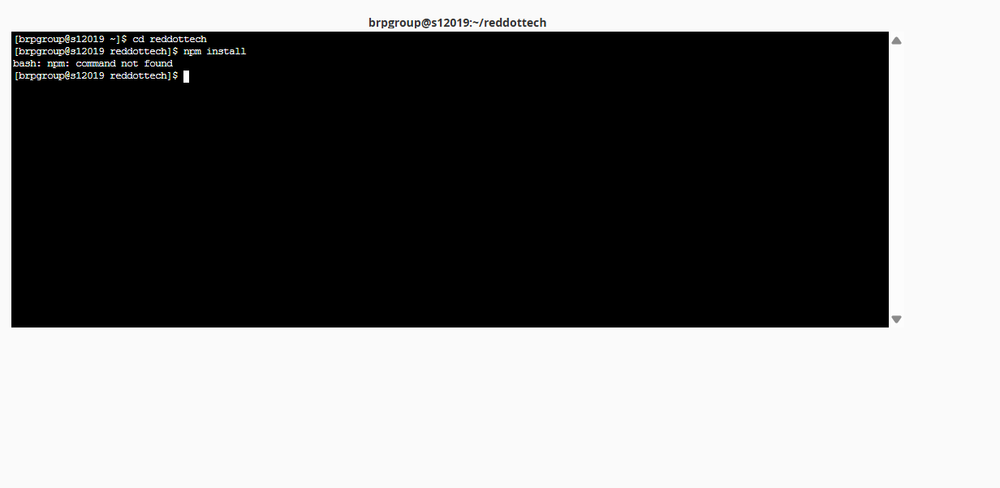

# 🚀 Complete cPanel Deployment Guide for Red Dot Technologies

This guide walks you through deploying the full-stack **Red Dot Technologies** website (React SSR + Express API + MySQL Database) on **cPanel** from scratch.

---

## 📦 What is Inside the Deployment Package?

We have already packaged the complete application for you into:
📍 **`cpanel-deploy.tar.gz`** _(Recommended)_ & **`cpanel-deploy.zip`** (Located in: `reddottech-react/`)

> [!TIP]
> **Why use `cpanel-deploy.tar.gz`?**
> Some cPanel servers have an antivirus rule called `Sanesecurity.Foxhole.JS_Zip` that blocks `.zip` files containing `.js` code files. **`cpanel-deploy.tar.gz`** is natively supported by cPanel File Manager and completely bypasses this false-positive rule!

Whenever you make future code updates, you can re-generate the package in 1 click by running in your terminal:

```bash
npm run package:cpanel
```

---

## 📋 Step-by-Step Deployment Instructions

### STEP 1: Create the MySQL Database & User in cPanel

1. Log in to your **cPanel Dashboard**.
2. Under the **Databases** section, click **MySQL® Database Wizard**.
3. **Step 1: Create A Database**:
   - Enter a database name (e.g., `reddot_db`).
   - Click **Next Step**.
4. **Step 2: Create Database Users**:
   - Enter a username (e.g., `reddot_user`).
   - Click **Password Generator** to create a strong password. **Copy and save this password!**
   - Click **Create User**.
5. **Step 3: Add User to the Database**:
   - Check the box **ALL PRIVILEGES**.
   - Click **Make Changes** / **Next Step**.
6. _Note down your full Database Name, Username, and Password._ (e.g., `cpaneluser_reddot_db`, `cpaneluser_reddot_user`).
   databasename : reddot_db
   username: reddot_user
   password: Database_user

---

### STEP 2: Import the Database Schema into phpMyAdmin

1. Back on the main cPanel dashboard, click **phpMyAdmin** (under Databases).
2. In the left sidebar, click on your newly created database (e.g., `cpaneluser_reddot_db`).
3. Click the **Import** tab in the top navigation bar.
4. Under **File to import**, click **Choose File** and select `server/schema.sql`.
5. Scroll to the bottom and click **Import** (or **Go**).
6. ✅ All 8 tables (`courses`, `certificates`, `leads`, `contacts`, `subscriptions`, `admins`, `settings`, `migrations`) and all initial authentic data will be loaded!

---

### STEP 3: Upload the Files to cPanel

1. In cPanel, click **File Manager** (under Files).
2. In the left panel, click on your home directory (e.g. `/home/username/`).
3. Click **+ Folder** in the top toolbar to create a new folder named:
   📁 **`reddottech`**
4. Double-click to open the `reddottech` folder.
5. Click **Upload** in the top toolbar.
6. Drag and drop **`cpanel-deploy.tar.gz`** and wait until the progress bar turns green (100%).
7. Go back to File Manager, right-click on `cpanel-deploy.tar.gz` and select **Extract** -> **Extract Files**.
8. You will now see:
   - `dist/`
   - `server/`
   - `public/`
   - `package.json`
   - `package-lock.json`
   - `.env.example`

---

### STEP 4: Setup the Node.js Application in cPanel

1. In cPanel, search for **Setup Node.js App** (sometimes called **Node.js Selector**) and click it.
2. Click the blue **Create Application** button.
3. Fill out the application settings:
   - **Node.js version**: Select **`20.x`** (or `18.x`).
   - **Application mode**: Select **`Production`**.
   - **Application root**: Enter **`reddottech`** (the folder you created in Step 3).
   - **Application URL**: Select your domain (e.g., `reddottech.com.np` or `www.reddottech.com.np`).
   - **Application startup file**: Enter **`server/prod-entry.js`**.
4. In the **Environment variables** section, click **Add Variable** and add the following keys:
   - `NODE_ENV` = `production`
   - `PORT` = `5000`
   - `DB_HOST` = `localhost`
   - `DB_PORT` = `3306`
   - `DB_NAME` = _Your cPanel Database Name from Step 1_
   - `DB_USER` = _Your cPanel Database User from Step 1_
   - `DB_PASSWORD` = _Your cPanel Database Password from Step 1_
   - `JWT_SECRET` = `reddot_jwt_super_secure_key_2026`
   - `CORS_ORIGINS` = `https://reddottech.com.np,https://www.reddottech.com.np`
5. Click **Create** in the top-right corner.

---

Run these 3 lines one by one (press Enter after each):

bash
source /home/brpgroup/nodevenv/reddottech/20/bin/activate
bash
cd /home/brpgroup/reddottech
bash
npm install

### STEP 5: Install Dependencies & Launch

1. Once the application is created, you will see a button named **"Run NPM Install"** (or **"NPM Install"**). Click it and wait 1-2 minutes for the packages to install.
   _(Alternative: Copy the virtual environment command shown at the top of the Node.js app page, open cPanel **Terminal**, paste the command, and run `npm install --omit=dev`)_.
2. Click **Start Application** (or **Restart Application** if it's already started).
3. Visit **`https://reddottech.com.np`** in your browser!

---

## 🔐 Default Admin Login

Once deployed, you can access the admin dashboard at:

- **URL**: `https://reddottech.com.np/admin/login`
- **Default Username / Email**: `admin@reddottech.com.np`
- **Default Password**: `admin123` _(Be sure to change this password in Admin Settings after your first login!)_

---

## 💡 Helpful Tips

- **SSL Certificate**: Make sure **Let's Encrypt SSL** / **AutoSSL** is enabled under cPanel -> **SSL/TLS Status** for `https://` padlock.
- **Troubleshooting**: If you ever see a 503 error, open cPanel -> **Setup Node.js App** -> click the edit pencil icon next to your app -> click **Restart**, or check the error log file located inside `/home/username/reddottech/stderr.log`.
