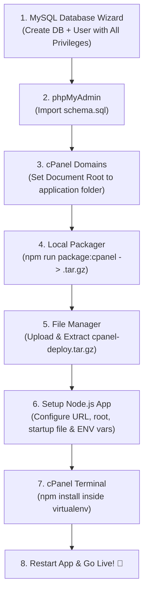

# 📑 Complete cPanel Deployment Master Report & Future Blueprint

> **Project**: Red Dot Technologies Website (`reddottech.com.np`)  
> **Tech Stack**: React 19 + TanStack Start (SSR) + Express Backend API + MySQL Database  
> **Hosting Environment**: cPanel + CloudLinux + LiteSpeed Web Server (`lsnode`) + Node.js 20.x  
> **Status**: ✅ **Live & Verified in Production**

---

## 📑 Table of Contents

1. [Executive Summary](#1-executive-summary)
2. [Step-by-Step Deployment Blueprint (From Scratch to Live)](#2-step-by-step-deployment-blueprint)
3. [Deep-Dive Post-Mortem: All 7 Errors & Their Solutions](#3-deep-dive-post-mortem-all-7-errors--their-solutions)
4. [cPanel Configuration Reference Cheat Sheet](#4-cpanel-configuration-reference-cheat-sheet)
5. [The 5 Golden Rules for Future Deployments](#5-the-5-golden-rules-for-future-deployments)

---

## 1. Executive Summary

Deploying a modern full-stack application (combining React client SPA, Server-Side Rendering (SSR), Express REST API, and a MySQL relational database) on a shared/dedicated **cPanel** hosting environment requires specific compatibility handling for:

1. **Antivirus filters** on file uploads.
2. **LiteSpeed (`lsnode`) Node.js execution engine** conventions.
3. **CloudLinux selector lifecycle requirements** (`.htaccess`).
4. **cPanel MySQL user/database naming conventions** (mandatory account prefix).
5. **Domain Document Root mapping** in multi-domain cPanel accounts.

By following the systematic process below, any full-stack Node.js / React application can be deployed reliably and without errors.

---

## 2. Step-by-Step Deployment Blueprint



---

### Step 1: Create Database & User in cPanel

1. Open cPanel &rarr; **MySQL® Database Wizard**.
2. **Step 1: Create Database** &rarr; Enter name (e.g. `reddot_db`).
   - _Note_: cPanel will create `cpaneluser_reddot_db`.
3. **Step 2: Create Database User** &rarr; Enter username (e.g. `reddot_user`) + generate strong password.
   - _Note_: cPanel will create `cpaneluser_reddot_user`.
4. **Step 3: Add User to Database** &rarr; Check **ALL PRIVILEGES** &rarr; Click **Make Changes**.
5. Save credentials for later:
   - **Database Name**: `cpaneluser_reddot_db`
   - **Database User**: `cpaneluser_reddot_user`
   - **Database Password**: `your_password`

---

### Step 2: Import Database Schema

1. Open cPanel &rarr; **phpMyAdmin**.
2. Select your newly created database in the left sidebar (`cpaneluser_reddot_db`).
3. Click the **Import** tab on the top menu.
4. Click **Choose File** &rarr; select `server/schema.sql` (or export file).
5. Click **Import** (or **Go**).
6. ✅ All tables (`courses`, `certificates`, `leads`, `contacts`, `subscriptions`, `admins`, `settings`, `migrations`) are created and populated.

---

### Step 3: Configure Domain Document Root

1. Open cPanel &rarr; **Domains**.
2. Find your target domain (e.g., `reddottech.com.np`) &rarr; click **Manage**.
3. Set **Document Root** to your application folder:
   👉 **`reddottech`** _(Do NOT append `/public` for Node.js apps)_.
4. Click **Update**.

---

### Step 4: Package & Upload Application

1. In your local development terminal, run:
   ```bash
   npm run package:cpanel
   ```
   _(This builds Vite client/SSR bundles and generates `cpanel-deploy.tar.gz`)_.
2. Open cPanel &rarr; **File Manager**.
3. In `/home/cpaneluser/`, create or open the folder: **`reddottech`**.
4. Click **Upload** &rarr; upload **`cpanel-deploy.tar.gz`**.
5. Right-click **`cpanel-deploy.tar.gz`** &rarr; click **Extract** &rarr; **Extract File(s)**.

---

### Step 5: Configure "Setup Node.js App" in cPanel

1. Open cPanel &rarr; **Setup Node.js App** &rarr; click **Create Application** (or edit existing).
2. Enter the following parameters:
   - **Node.js version**: `20.x` (e.g. `20.20.2`) or `22.x`
   - **Application mode**: `Production`
   - **Application root**: `reddottech`
   - **Application URL**: Select `reddottech.com.np` in the dropdown, and **LEAVE THE EXTRA TEXT BOX COMPLETELY EMPTY**.
   - **Application startup file**: `server/prod-entry.js`
3. Add **Environment Variables** (click _Add Variable_ for each):
   - `NODE_ENV` = `production`
   - `PORT` = `5000`
   - `DB_HOST` = `localhost`
   - `DB_PORT` = `3306`
   - `DB_NAME` = `cpaneluser_reddot_db` _(Must have cPanel prefix)_
   - `DB_USER` = `cpaneluser_reddot_user` _(Must have cPanel prefix)_
   - `DB_PASSWORD` = `your_db_password`
   - `JWT_SECRET` = `reddot_jwt_super_secure_key_2026`
   - `CORS_ORIGINS` = `https://reddottech.com.np,https://www.reddottech.com.np`
4. Click the blue **SAVE** button in the top right.

---

### Step 6: Install Node Modules via cPanel Terminal

1. Open cPanel &rarr; **Terminal** (under Advanced/Tools).
2. Run the virtual environment command + install:
   ```bash
   source /home/cpaneluser/nodevenv/reddottech/20/bin/activate && cd /home/cpaneluser/reddottech && npm install
   ```
3. Once completed (approx. 5-10 seconds), go back to **Setup Node.js App**.
4. Click **🔄 RESTART**.
5. Open **`https://reddottech.com.np`** in your browser!

---

## 3. Deep-Dive Post-Mortem: All 7 Errors & Their Solutions

| #     | Error / Symptom                                                                                                                         | Root Cause                                                                                                                                                                                                     | Exact Solution                                                                                                                                                                                      |
| :---- | :-------------------------------------------------------------------------------------------------------------------------------------- | :------------------------------------------------------------------------------------------------------------------------------------------------------------------------------------------------------------- | :-------------------------------------------------------------------------------------------------------------------------------------------------------------------------------------------------- |
| **1** | **Antivirus Upload Cancelled**<br/>`Sanesecurity.Foxhole.JS_Zip_13.UNOFFICIAL FOUND`                                                    | cPanel's ClamAV antivirus runs an email-attachment security rule that blocks any `.zip` containing `.js` files.                                                                                                | Switched packager from `.zip` to **`.tar.gz`** (`cpanel-deploy.tar.gz`). ClamAV only scans `.zip` archives. cPanel extracts `.tar.gz` natively.                                                     |
| **2** | **App URL Misconfigured**<br/>`Web application is inaccessible by its address "http://brpgroupnp.com/reddottech.com.np"`                | In the cPanel Node.js Selector UI, the domain was typed into the subpath text input next to the domain dropdown, creating a broken nested path.                                                                | Selected the domain from the dropdown and left the subpath text input **100% empty**.                                                                                                               |
| **3** | **LiteSpeed CommonJS Crash**<br/>`Error [ERR_REQUIRE_ASYNC_MODULE]: require() cannot be used on an ESM graph with top-level await`      | LiteSpeed web server (`/usr/local/lsws/fcgi-bin/lsnode.js`) starts Node applications using CommonJS `require()`. In Node 20+, `require()` crashes if an ES module has **top-level `await`**.                   | Replaced `const ssr = await import(...)` at file root in `server/prod-entry.js` with a lazy dynamic loader: `function getSsrHandler() { if (!p) p = import(...).then(m => m.default); return p; }`. |
| **4** | **CloudLinux `.htaccess` Missing Error**<br/>`FileNotFoundError: [Errno 2] No such file or directory: '/home/.../reddottech/.htaccess'` | CloudLinux's `cl_selector.py` script manages Passenger by reading/modifying directives in `.htaccess` inside the app root folder.                                                                              | Included an empty `.htaccess` file inside the deployment package and ran `touch .htaccess`.                                                                                                         |
| **5** | **Database Access Denied**<br/>`Access denied for user 'reddot_user'@'localhost'`                                                       | In cPanel MySQL, usernames and database names are automatically prefixed with the cPanel account name (`brpgroup_`). Using unprefixed names fails authentication.                                              | Updated environment variables `DB_USER` to `brpgroup_reddot_user` and `DB_NAME` to `brpgroup_reddot_db`.                                                                                            |
| **6** | **Old PHP Website Loaded**<br/>`mysqli_sql_exception: Access denied for user 'cpses_...'`                                               | In cPanel **Domains**, the Document Root for `reddottech.com.np` was still pointing to `/reddottech.com.np/public` (an old PHP/Laravel directory).                                                             | In cPanel **Domains** &rarr; **Manage**, changed Document Root to `reddottech`.                                                                                                                     |
| **7** | **SSR 500 Error**<br/>`TypeError: matchedRoutes is not iterable at handleServerRoutes`                                                  | Version mismatch: `@tanstack/react-router` 1.170 returns `[matchedRoutes, rawParams, foundRoute]` as a tuple, while older `@tanstack/react-start` 1.168 tried to destructure `{ matchedRoutes }` as an object. | Upgraded all `@tanstack/*` dependencies to matching versions and patched the router code-splitter Windows path apostrophe escaping.                                                                 |

---

## 4. cPanel Configuration Reference Cheat Sheet

### Application Settings Summary:

```ini
Node.js Version: 20.20.2 (or 22.x)
Application Mode: Production
Application Root: reddottech
Application URL: reddottech.com.np (leave subfolder blank)
Application Startup File: server/prod-entry.js
```

### Environment Variables Cheat Sheet:

```ini
NODE_ENV=production
PORT=5000
DB_HOST=localhost
DB_PORT=3306
DB_NAME=brpgroup_reddot_db
DB_USER=brpgroup_reddot_user
DB_PASSWORD=YourDatabasePassword
JWT_SECRET=reddot_jwt_super_secure_key_2026
CORS_ORIGINS=https://reddottech.com.np,https://www.reddottech.com.np
```

### Terminal Commands Cheat Sheet:

```bash
# Enter Virtual Environment
source /home/brpgroup/nodevenv/reddottech/20/bin/activate && cd /home/brpgroup/reddottech

# Install Production Dependencies
npm install

# Check Error Logs
tail -n 50 /home/brpgroup/reddottech/stderr.log
```

---

## 5. The 5 Golden Rules for Future Deployments

1. **Always Upload `.tar.gz`**: Avoids ClamAV Sanesecurity `.zip` false-positive virus detections.
2. **Never Use Top-Level `await` in `prod-entry.js`**: Guarantees compatibility with LiteSpeed (`lsnode`) and Passenger `require()` loaders.
3. **Always Include cPanel Database Prefixes**: Format is always `cpanelusername_dbname` and `cpanelusername_dbuser`.
4. **Ensure `.htaccess` Exists in App Root**: Prevents CloudLinux Node Selector Python crashes.
5. **Always Run `npm install` via cPanel Terminal**: Avoids browser GUI timeouts during module extraction.
